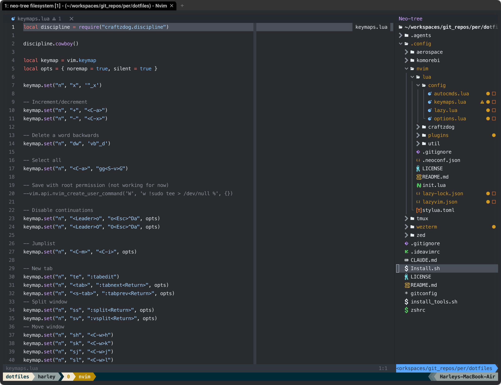
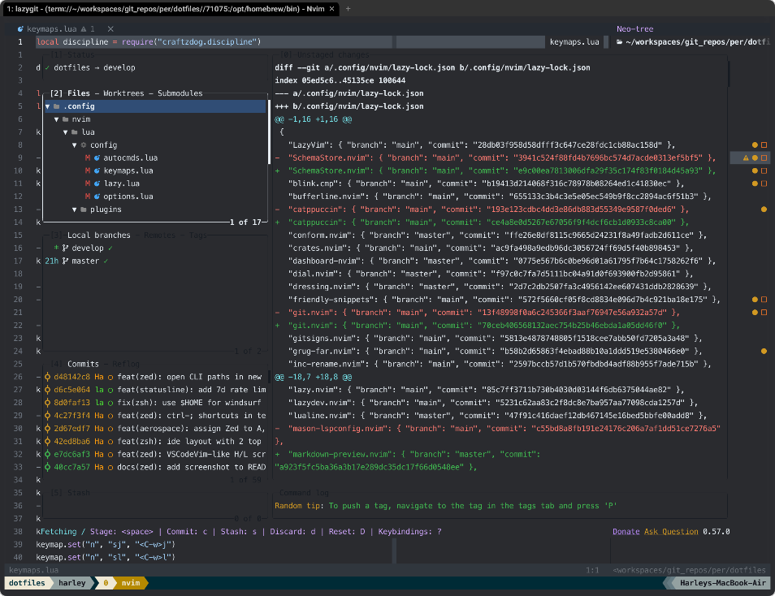

# Neovim config (LazyVim)

[LazyVim](https://lazyvim.github.io) 16 config (Neovim 0.12), kept in line with my [Zed config](../zed/README.md):
same `;` shortcuts, explorer on the right, GitHub Dark theme.





## Install

```bash
brew install neovim tree-sitter-cli fd ripgrep lazygit      # nvim >= 0.12; tree-sitter CLI builds parsers
mv ~/.config/nvim ~/.config/nvim.bak-$(date +%Y%m%d-%H%M%S)   # backup
ln -s "$PWD/.config/nvim" ~/.config/nvim                      # symlink: edits in the repo apply directly
nvim --headless "+Lazy! restore" +qa                           # install plugins at lazy-lock.json versions
```

`~/.config/nvim` is a **symlink** to this folder, so `lazy-lock.json` updates land in the repo.
After changing config: `:restart` (Neovim 0.12), then `<leader>qs` to restore the session —
or `:source %` for `config/*.lua`, `:Lazy reload <plugin>` for plugin opts.

```
.config/nvim/
├── README.md, images/          # docs (not copied)
├── init.lua
├── lazyvim.json                # enabled LazyVim extras
├── lazy-lock.json              # plugin versions
└── lua/
    ├── config/                 # options, keymaps, autocmds, lazy.nvim bootstrap
    ├── plugins/                # plugin specs (ui, editor, coding, lsp, treesitter, colorscheme, lint)
    └── craftzdog/              # helpers (cowboy discipline, color utils)
```

## Keymap

Leader is `<Space>`. Only custom keys are listed — LazyVim defaults (`<leader>ff`, `<leader>gg`, …) still work.

### `;` shortcuts — same as Zed

| Keys | Action | Zed |
|---|---|---|
| `;w` | save | `; w` |
| `;e` | reveal current file in Neo-tree / jump back to the editor | `; e` |
| `;f` | find file (Telescope, hidden files, respects `.gitignore`) | `; f` |
| `;r` | live grep | `; r` |
| `;d` | close other buffers | `; d` |
| `;o` | outline — symbols panel on the right (Trouble) | `; o` |
| `;g` | lazygit in a float (git root) | `; g` (Git Graph) |
| `;t` / `;s` / `;;` | help tags / treesitter symbols / resume last picker | — |
| `\\` | open buffers | — |

### Navigation

| Keys | Action | Notes |
|---|---|---|
| `H` / `L` | `H5k` / `L5j` | like Zed/VSCodeVim: screen top/bottom, each repeat scrolls 5 lines |
| `tn` / `tp` | next / previous buffer | same as Zed `t n` / `t p` |
| `<Tab>` / `<S-Tab>` | next / previous tab | |
| `te` | `:tabedit` | |
| `ss` / `sv` | split below / right | |
| `sh` `sj` `sk` `sl` | move to window left / down / up / right | |
| `<C-w><arrows>` | resize window | |
| `<C-b>` | toggle Neo-tree | |
| `sf` | Telescope file browser in the current file's directory | |
| `<C-j>` | next diagnostic | |
| `gh` | LSP hover | |

### Editing

| Keys | Action |
|---|---|
| `jk` / `jj` (insert) | leave insert mode |
| `x` / `dw` | delete without yanking (`dw` deletes the word backwards) |
| `+` / `-` | increment / decrement |
| `<C-a>` | select all |
| `<leader>o` / `<leader>O` | new line below / above without continuing a comment |
| `<leader>r` | normal: hex → HSL · visual: refactor menu |
| `<leader>cc` | generate doc comment (neogen) |
| `<leader>cs` | symbols (Trouble — LazyVim default, same as `;o`) |
| `<leader>gb` / `<leader>go` | git blame / open in browser |
| `<leader>z` | zen mode |

> ⚠️ `t` and `s` are prefixes here, so vim's `t{char}` and `s` wait for `timeoutlen` (300 ms).
> `cowboy()`: holding `h/j/k/l/+/-` more than 50 times within 2 s blocks the key and shows "Hold it Cowboy!" —
> use counts, `H`/`L`, search or `;f` instead.

## Settings

### Look
- Colorscheme `github_dark` (`projekt0n/github-nvim-theme`, `transparent = true` so WezTerm's opacity/blur shows through);
  lualine `theme = "auto"`, incline uses `TabLineSel`/`TabLine` — one palette everywhere, same as Zed and WezTerm.
- No animations: `vim.g.snacks_animate = false`, snacks scroll off.
- Start screen: `snacks.dashboard` with the DEVASLIFE logo.
- `colorcolumn = 80` (Zed `wrap_guides`), relative numbers (LazyVim default).

### Explorer (Neo-tree)
- `position = "right"`, `width = 35` (≈ Zed's 280 px) with `winfixwidth`, so splits and `<C-w>=` keep its width.
- Dotfiles and gitignored files shown; `.git`, `.yarn`, `node_modules`, `.DS_Store` never shown (Zed `file_scan_exclusions`).

### Editing
- Autosave on `FocusLost` / `BufLeave` (Zed `autosave: on_focus_change`) — saving runs format-on-save + ESLint fix (`linting.eslint` extra).
- System clipboard, `shiftwidth = 2`, `shell = zsh`.
- Extras: eslint, prettier, typescript, json, rust, tailwind, yaml, markdown, telescope, mini-hipatterns.
- Tailwind LSP: `classAttributes`, `classFunctions` (`cva`, `cx`) and `classRegex` for `cva`/`cx`/`cn` — same as Zed.
- TypeScript LSP: `vtsls`. Inlay hints like VSCode — only parameter names for literal arguments
  (no return / parameter / property / variable types; `K` shows a type).
- Completion: blink.cmp (+ `blink-emoji`). Refactoring: `refactoring.nvim` 2.x (needs `async.nvim`), visual `<leader>r`.
