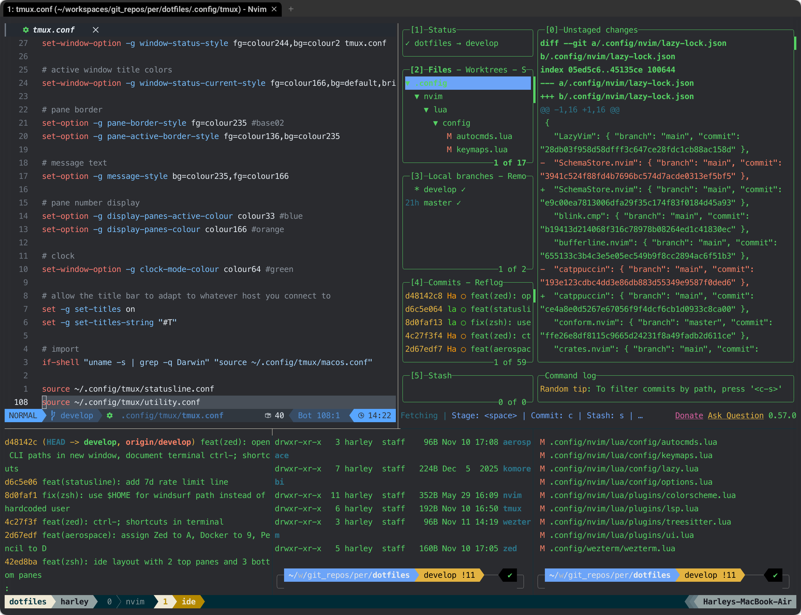

# tmux config

tmux 3.6 config: `C-t` prefix, vim-style pane keys, solarized status line.



## Install

```bash
mkdir -p ~/.config/tmux
cp .config/tmux/*.conf ~/.config/tmux/
tmux source-file ~/.config/tmux/tmux.conf   # or prefix + r inside tmux
```

```
.config/tmux/
├── tmux.conf         # main: prefix, keys, options; sources the files below
├── macos.conf        # macOS only: clipboard, undercurl
├── statusline.conf   # status line / borders / messages (solarized)
└── utility.conf      # popups (lazygit)
```

## Keys

Prefix is **`C-t`** (instead of `C-b`). `repeat-time 0`: `-r` keys don't repeat without the prefix.

| Keys | Action |
|---|---|
| `prefix \|` / `prefix -` | split right / split down |
| `prefix h` `j` `k` `l` | select pane left / down / up / right |
| `prefix C-h` `C-j` `C-k` `C-l` | resize pane by 5 |
| `prefix m` | zoom pane |
| `prefix e` | kill all other panes |
| `prefix g` | lazygit popup (80% × 80%) in the current pane's directory |
| `prefix o` | open the current directory in Finder |
| `prefix r` | reload config |
| `C-S-Left` / `C-S-Right` | move window left / right (also with `M-`) |
| copy mode `v` / `y` | begin selection / copy (vi `mode-keys`) |

Mouse is on (select / resize panes).

## `ide` layout

`ide` (shell function in [`zshrc`](../../zshrc)) splits the current window into 2 top panes and 3 bottom panes
(the screenshot above: nvim + lazygit on top, shells below):

```
┌──────────────┬──────────────┐
│              │              │
│   (current)  │              │   70%
│              │              │
├─────────┬────┴────┬─────────┤
│         │         │         │   30%
└─────────┴─────────┴─────────┘
```

## Settings

- `default-terminal xterm-256color` + `Tc` (true color), undercurl overrides on macOS
- `escape-time 10` (no Esc lag in nvim), `focus-events on` (nvim autosave on focus change)
- `history-limit 64096`, `set-titles on`
- Status line: session · user on the left, windows, hostname on the right (`statusline.conf`)
