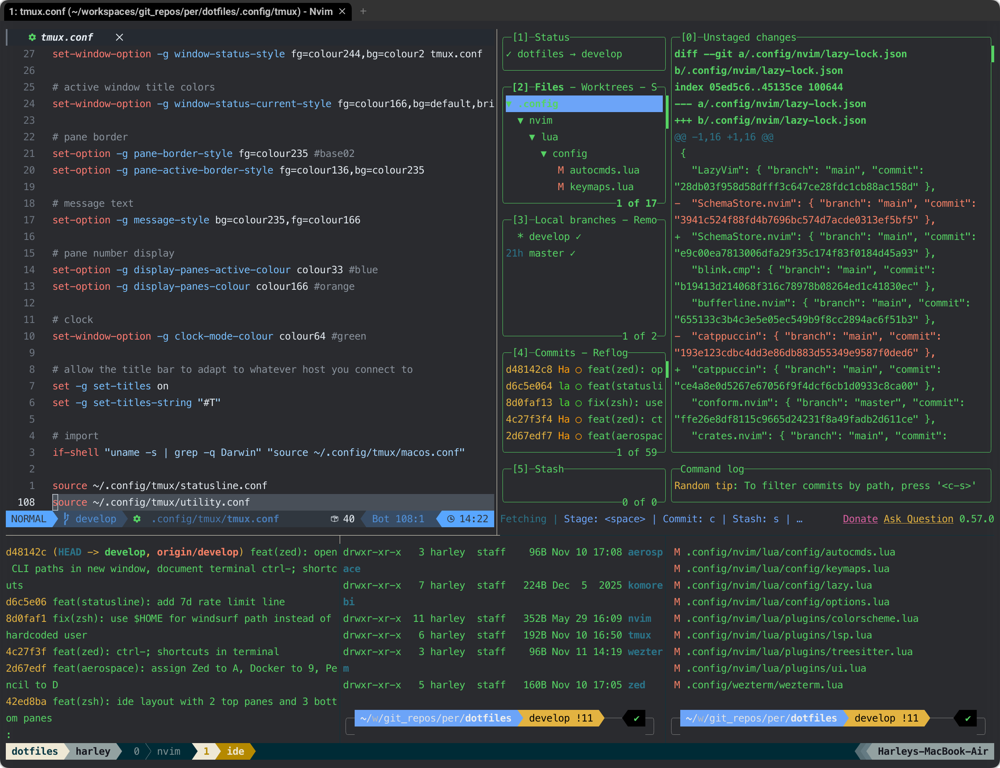

# WezTerm config

Terminal for nvim + tmux, matched to [Zed](../zed/README.md)'s terminal: same font, size, line height and theme.



## Install

```bash
mkdir -p ~/.config/wezterm
cp .config/wezterm/wezterm.lua ~/.config/wezterm/
```

WezTerm hot-reloads the config.

## Settings

| Setting | Value | Why |
|---|---|---|
| `font` / `font_size` | `MesloLGS NF` / 12 | same as Zed `buffer_font_family` / `terminal.font_size` |
| `line_height` | 1.3 | Zed terminal `line_height: "standard"` (1.5 made the tmux status line too tall) |
| `color_scheme` | `GitHub Dark` (built-in) | same as Zed theme and nvim `github_dark` |
| `window_background_opacity` | 0.85 | nvim/tmux are transparent, so this shows through |
| `macos_window_background_blur` | 30 | costs GPU every frame — lower or remove if rendering feels laggy |
| `max_fps` | 120 | smoother on ProMotion displays |
| `window_decorations` | `RESIZE` | no title bar |

On Windows only (`wezterm.target_triple`): default to WSL and add PowerShell / pwsh / WSL to the launch menu.
