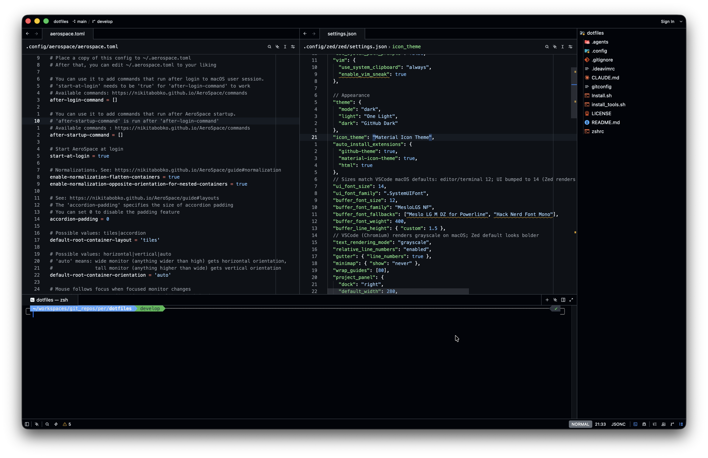

# Zed config

Zed (v1.27) config aligned with my VSCode setup (vim mode).



## Install

```bash
cp -R ~/.config/zed ~/.config/zed.bak-$(date +%Y%m%d-%H%M%S)   # backup
mkdir -p ~/.config/zed/snippets
cp .config/zed/zed/settings.json .config/zed/zed/keymap.json ~/.config/zed/
cp .config/zed/zed/snippets/*.json ~/.config/zed/snippets/
```

Enable key repeat when holding `h`/`j`/`k`/`l` in vim mode (disable macOS press-and-hold accents for Zed):

```bash
defaults write dev.zed.Zed ApplePressAndHoldEnabled -bool false   # then restart Zed
```

Zed hot-reloads config files. `text_rendering_mode` needs a Zed restart.

```
.config/zed/
├── README.md            # this file (not copied)
├── images/              # README screenshots (not copied)
└── zed/                 # → ~/.config/zed/
    ├── settings.json
    ├── keymap.json
    └── snippets/
        ├── snippets.json          # global snippets
        └── typescriptreact.json   # TSX snippets
```

## Keymap (`keymap.json`)

### Editor — vim Normal / Visual

| Keys | Action | Notes |
|---|---|---|
| `; w` | `workspace::Save` | save file |
| `; e` | `project_panel::ToggleFocus` | focus / leave explorer |
| `; f` | `file_finder::Toggle` | find file (quick open) |
| `; r` | `pane::DeploySearch` | search text across project |
| `; d` | `pane::CloseInactiveItems` | close other tabs |
| `; o` | `outline_panel::ToggleFocus` | outline |
| `; g` | `git_graph::Open` | Git Graph (built-in, no extension needed) |
| `alt-n alt-p` / `alt-n alt-n` | `workspace::ActivatePreviousPane` / `ActivateNextPane` | switch pane |
| `ctrl-shift-alt-=` / `ctrl-shift-alt--` | `vim::ResizePaneRight` / `ResizePaneLeft` | resize pane |
| `H` / `L` | `action::Sequence [vim::WindowTop, "5 k"]` / `[vim::WindowBottom, "5 j"]` | like VSCodeVim: jump to screen top/bottom, each repeat scrolls 5 lines |

**Zed-only extras** (not in VSCode):

| Keys | Action |
|---|---|
| `t n` / `t p` | next / previous tab |
| `s v` / `s h` | split right / split down |
| `n n` / `n p` | pane right / pane left |

> ⚠️ These shadow native vim keys: `t{char}`, `s`, and `n` (next search match).
> A lone `t` / `s` / `n` waits for the keymap timeout (~1s) before running;
> pressing `n` twice quickly switches pane instead of jumping two search matches.

### Editor — vim Insert

| Keys | Action |
|---|---|
| `j k` | leave insert mode (`escape`) |

### Explorer (`ProjectPanel && not_editing`)

| Keys | Action |
|---|---|
| `a` / `ctrl-n` / `cmd-n` | new file |
| `alt-cmd-n` | new folder (also works anywhere in the Workspace) |
| `r` | rename |
| `c` / `p` | copy / paste |
| `d` | delete (with confirmation) |
| `; f` / `; r` / `; e` / `; g` | same as in the editor |
| `; d` | `SendKeystrokes "; e ; d"` — jump back to the editor, then close other tabs (pane actions don't reach the panel) |

### Notes

- To open a file by **absolute path outside the project**: `cmd-o`, then paste the path.
  `; f` / `cmd-p` (file finder) only matches files inside the open project, unlike VSCode quick open.
- The **Git Graph** search box grabs focus on open, so typing `;e` ends up as text. Leave it with
  `Esc`, by clicking the commit list, `cmd-shift-e` (explorer) or `cmd-w` (close tab).

## Settings (`settings.json`)

### General
- `base_keymap: VSCode`, `vim_mode: true`
- `vim.use_system_clipboard: always`, `vim.enable_vim_sneak: true` (like `vim.sneak`)
- `use_system_path_prompts: false` — `cmd-o` shows Zed's path prompt (type/paste an absolute path, with autocomplete)

### Appearance
| Setting | Value | VSCode equivalent |
|---|---|---|
| `theme` | dark: `GitHub Dark` (extension `github-theme`) | `GitHub Dark Default` — the Zed extension has no "Default" variant |
| `icon_theme` | `Material Icon Theme` | `material-icon-theme` |
| `auto_install_extensions` | `github-theme`, `material-icon-theme`, `html` | |
| `ui_font_family` / `ui_font_size` | `.SystemUIFont` / 14 | workbench SF 13 (Zed renders UI text smaller, so +1) |
| `buffer_font_family` / `buffer_font_size` | `MesloLGS NF` / 12 | `editor.fontFamily`, default 12 |
| `buffer_font_fallbacks` | `Meslo LG M DZ for Powerline`, `Hack Nerd Font Mono` | |
| `buffer_line_height` | `{ custom: 1.5 }` | |
| `text_rendering_mode` | `grayscale` | VSCode/Chromium renders grayscale → thinner glyphs |
| `relative_line_numbers` | `enabled` | `editor.lineNumbers: relative` |
| `minimap.show` | `never` | `editor.minimap.enabled: false` |
| `wrap_guides` | `[80]` | `editor.rulers` |
| `preview_tabs.enabled` | `false` | `workbench.editor.enablePreview: false` |

### Explorer (`project_panel`)
- `dock: right` — like `workbench.sideBar.location: right`
- `default_width: 280`, `indent_size: 12`
- `scrollbar.horizontal_scroll: false` — no horizontal scrolling; long names are truncated with `…`

### Editing / formatting
- `tab_size: 2`, `autosave: on_focus_change`, `format_on_save: on`
- `edit_predictions.provider: none`, `inlay_hints.enabled: true`
- `file_scan_exclusions`: `.git`, `.yarn`, `node_modules`, `.DS_Store`
- `prettier` (fallback when the project has no `.prettierrc`):
  `singleQuote`, `tabWidth 2`, `printWidth 120`, `arrowParens avoid`, `trailingComma es5`
- TypeScript / TSX / JavaScript: `formatter: [{ code_action: "source.fixAll.eslint" }, "prettier"]`
  — ESLint fixAll, then Prettier on save (like `editor.codeActionsOnSave`)

### LSP
- `typescript-language-server` / `vtsls`: parameter-name inlay hints for `literals`, update imports on file move
- `tailwindcss-language-server`: `classAttributes`, `classFunctions` (`cva`, `cx`), `experimental.classRegex` for `cva`/`cx`/`cn` — ported from VSCode

### Terminal
- `font_family: MesloLGS NF` + same fallbacks as the editor, `font_size: 12`, `line_height: standard`
- `env.FIG_NEW_SESSION`

### Agent
- `agent_servers.claude-acp` (registry)

## Snippets

- `snippets/snippets.json` (global): `log`, `logv`, `logvs`, `redux-action`, `expit`,
  `deso`, `cl`, `crud`, `bbmd`, `rtkq`, `aicon`, `bcmd`
- `snippets/typescriptreact.json`: React/TS snippet set (`exptp`, `expint`, `tpf`, ...)
